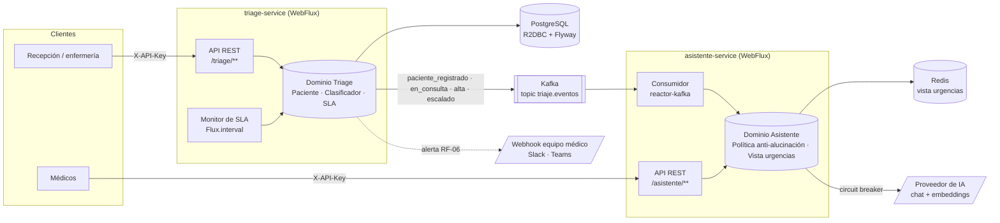
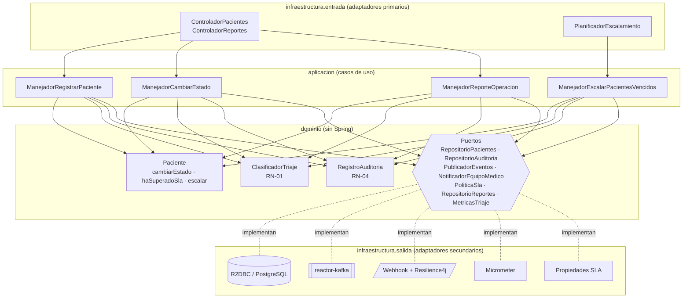
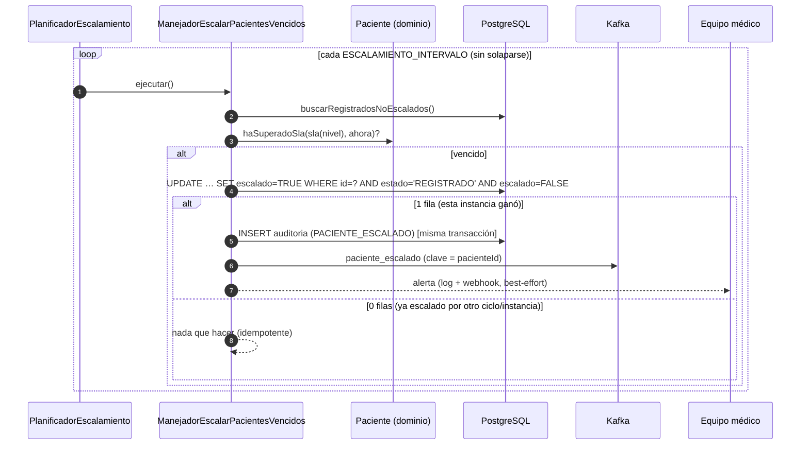
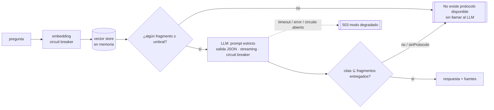

# VidaCruz · Triaje digital con asistente clínico

Sistema de backend reactivo para las salas de urgencias de VidaCruz: clasifica pacientes de forma
objetiva (RN-01), vigila los tiempos de atención y escala automáticamente (RF-03), deja auditoría clínica
inmutable (RN-04) y ofrece a los médicos un asistente que consulta los protocolos internos con IA
generativa **sin inventar contenido** (RN-05).

| Servicio | Puerto | Responsabilidad |
|----------|--------|-----------------|
| `triage-service` | 8081 | Registro y clasificación, flujo de estados, SLA y escalamiento, auditoría, reporte de operación, alertas al equipo médico |
| `asistente-service` | 8082 | Consulta de protocolos con RAG (citas obligatorias, modo degradado) y estado de urgencias en tiempo real reconstruido desde Kafka |

**Stack:** Java 21 · Spring Boot 3.5 · Spring WebFlux + Project Reactor · R2DBC/PostgreSQL 16 · Flyway ·
Apache Kafka (reactor-kafka) · Redis · Spring AI 1.1 · Resilience4j · Micrometer/Prometheus · Micrometer Tracing (OTel) ·
Testcontainers · Docker Compose · Kubernetes (AKS).

---

## 1. Ejecución local (un solo comando)

Requisitos: Docker Desktop (o Docker Engine + Compose v2). No hace falta Java ni Maven en la máquina.

```bash
cp .env.example .env        # edite LLM_API_KEY (y, si quiere, las API keys)
docker compose up --build   # PostgreSQL + Kafka + Redis + ambos servicios
```

Cuando los cinco contenedores estén `healthy`:

```bash
./scripts/demo.sh           # recorrido completo: registro, 400, estados, 409, auditoría, reporte, urgencias, RAG
```

Sin una `LLM_API_KEY` válida todo funciona salvo `POST /asistente/consulta`, que responde **503 en modo
degradado** (por diseño, ver ADR-003). Para una ejecución 100 % local sin claves externas, `.env.example`
documenta cómo apuntar a **Ollama**. El chat y los embeddings pueden venir de proveedores distintos: por
ejemplo **DeepSeek** para el chat (`LLM_BASE_URL=https://api.deepseek.com`, `LLM_CHAT_MODEL=deepseek-chat`) y
**Ollama** para los embeddings (`LLM_EMBEDDING_BASE_URL=http://host.docker.internal:11434`,
`LLM_EMBEDDING_API_KEY=ollama`, `LLM_EMBEDDING_MODEL=nomic-embed-text`, previo `ollama pull nomic-embed-text`),
ya que DeepSeek no ofrece modelo de embeddings.

Para desarrollar sin Docker para los servicios (solo infraestructura en contenedores):

```bash
docker compose up postgres kafka redis
TRIAGE_API_KEY=dev ./mvnw -pl triage-service spring-boot:run
ASISTENTE_API_KEY=dev LLM_API_KEY=sk-... ./mvnw -pl asistente-service spring-boot:run
```

### Probar el escalamiento sin esperar

Los SLA (RN-02) y el intervalo del monitor son configurables. En `.env`:

```
ESCALAMIENTO_INTERVALO=10s
SLA_CRITICO=30s
```

Registre un paciente CRÍTICO, espere ~40 s y consúltelo: `escalado: true`, entrada de auditoría
`PACIENTE_ESCALADO`, evento `paciente_escalado` en Kafka y alerta al equipo médico (log `ALERTA_ESCALAMIENTO`
y webhook si `ALERTAS_WEBHOOK_URL` está definido).

---

## 2. Arquitectura

### 2.1 Vista de contenedores



El triage **nunca** llama al asistente ni depende de su disponibilidad; la única relación es Kafka, asíncrona y
de un solo sentido (ADR-001).

### 2.2 Arquitectura hexagonal (puertos y adaptadores) dentro de cada servicio



Regla de dependencias: `infraestructura → aplicacion → dominio`. El dominio no importa nada de Spring; los
manejadores se ensamblan por constructor en `ConfiguracionCasosDeUso`. El asistente sigue el mismo esquema
con los puertos `BuscadorProtocolos`, `GeneradorRespuestas`, `VistaEstadoUrgencias` y `MetricasAsistente`.

```
triage-service/src/main/java/com/vidacruz/triage
├── dominio/            modelo · servicio · puerto · excepcion        ← reglas de negocio puras
├── aplicacion/         manejador · comando · respuesta               ← un caso de uso por clase
└── infraestructura/    entrada (rest, programado) · salida (persistencia, mensajeria, alertas) · configuracion
asistente-service/src/main/java/com/vidacruz/asistente
├── dominio/            modelo · servicio (PoliticaAntiAlucinacion) · puerto · excepcion
├── aplicacion/         manejador · respuesta
└── infraestructura/    entrada (rest, mensajeria) · salida (ia, redis) · configuracion
```

### 2.3 Flujo de escalamiento (RF-03 / RN-03)



### 2.4 Flujo de consulta con RAG (RF-04 A / RN-05)



---

## 3. API

Todas las rutas (salvo `/actuator/**`) exigen la cabecera `X-API-Key`. Formato de error único:
`{timestamp, estado, error, mensaje, campo?, ruta}`.

### triage-service

| Método | Ruta | Descripción | Códigos |
|--------|------|-------------|---------|
| `POST` | `/triage/pacientes` | Registra y clasifica (RN-01). Devuelve `id`, `nivel`, `slaMinutos`, `estado`, `fechaRegistro`… y publica `paciente_registrado` | 201, 400 (campo inválido), 401 |
| `PATCH` | `/triage/pacientes/{id}/estado` | `{"estado": "EN_CONSULTA" \| "ALTA"}`; audita y publica el evento | 200, 400, 404, 409 (transición inválida) |
| `GET` | `/triage/pacientes/{id}` | Datos completos, estado, `escalado`, `tiempoEnEstadoActual` | 200, 404 |
| `GET` | `/triage/pacientes/{id}/auditoria` | Trazabilidad clínica (solo lectura, RN-04) | 200, 404 |
| `GET` | `/triage/reportes/operacion?desde=…&hasta=…` | Por hora: total, conteo por nivel, espera promedio y p95 (SQL avanzado) | 200, 400 |

Ejemplo:

```bash
curl -s -X POST http://localhost:8081/triage/pacientes -H "X-API-Key: $TRIAGE_API_KEY" \
  -H 'Content-Type: application/json' --data-binary '{
  "nombreCompleto":"Elena Ruiz","edad":58,"frecuenciaCardiaca":130,"presionSistolica":180,
  "presionDiastolica":110,"spo2":97,"temperatura":36.8,"dolor":8,"gcs":15,"quejaPrincipal":"Dolor torácico"}'
# → 201 {"id":"…","nivel":"CRITICO","slaMinutos":5,"estado":"REGISTRADO","fechaRegistro":"2026-11-14T15:38:33Z",…}
```

### asistente-service

| Método | Ruta | Descripción | Códigos |
|--------|------|-------------|---------|
| `POST` | `/asistente/consulta` | `{"pregunta": "…"}` → `{"respuesta": "…", "fuentes": [{"protocolo": "PROTO-001", "seccion": "Medidas iniciales"}]}` | 200, 400, 401, **503 modo degradado** |
| `GET` | `/asistente/estado-urgencias` | Pacientes activos (no ALTA) por nivel, reconstruidos desde `triaje.eventos` | 200 |

Cuando no hay protocolo relevante la respuesta es exactamente el aviso *"No existe un protocolo disponible…"* con
`fuentes: []`, sin contenido clínico generado.

### Eventos (`triaje.eventos`)

JSON versionado, clave = `pacienteId`. Tipos: `paciente_registrado`, `paciente_en_consulta`, `paciente_alta`,
`paciente_escalado`. Contrato completo en [ADR-005](docs/adr/ADR-005-formato-eventos-y-vista-redis.md).

---

## 4. Reglas de negocio: dónde viven

| Regla | Implementación | Test |
|-------|----------------|------|
| RN-01 clasificación | `dominio/servicio/ClasificadorTriaje` (orden de gravedad, nivel 5 por queja administrativa sin tildes/mayúsculas) | `ClasificadorTriajeTest` (E1–E6 + bordes) |
| Validaciones RF-01 | `SignosVitales` (objeto de valor: si existe, es válido) y `Paciente.registrar` | `SignosVitalesTest`, `PacienteTest` |
| RF-02 transiciones | `EstadoPaciente.puedeTransicionarA` + `Paciente.cambiarEstado` → 409 | `PacienteTest`, `PacientesApiIT` |
| RN-02 SLA | Puerto `PoliticaSla` ← `PropiedadesSla` (configurable) | `PacientesApiIT` (SLA 0 s) |
| RN-03 idempotencia | `Paciente.escalar` (una vez, solo REGISTRADO) **y** `UPDATE … WHERE escalado=FALSE` atómico en BD | `ManejadorEscalarPacientesVencidosTest`, `PacientesApiIT` |
| RN-04 auditoría | `RegistroAuditoria` inmutable; sin endpoint de borrado; **trigger** en PostgreSQL que rechaza `UPDATE/DELETE` | `PacientesApiIT` |
| RF-05 SQL avanzado | `AdaptadorRepositorioReportes`: CTE + `ROW_NUMBER() OVER (PARTITION BY…)` + `COUNT(*) FILTER` + `PERCENTILE_CONT(0.95) WITHIN GROUP` | `PacientesApiIT` |
| RN-05 anti-alucinación | `PoliticaAntiAlucinacion` (umbral → decisión del modelo → verificación de citas) | `PoliticaAntiAlucinacionTest`, `AsistenteApiIT` |
| RF-06 alertas | Puerto `NotificadorEquipoMedico` ← `AdaptadorNotificadorWebhook` | `ManejadorEscalarPacientesVencidosTest` |

---

## 5. Decisiones clave (ADR)

| ADR | Decisión |
|-----|----------|
| [ADR-001](docs/adr/ADR-001-descomposicion-y-arquitectura-hexagonal.md) | Dos microservicios, hexagonal en cada uno, sin módulo compartido |
| [ADR-002](docs/adr/ADR-002-rag-y-vector-store.md) | Spring AI + vector store en memoria, umbral de similitud, corpus en Markdown versionado |
| [ADR-003](docs/adr/ADR-003-modo-degradado-proveedor-ia.md) | Circuit breaker + timeout → 503 explícito; streaming reactivo; bloqueantes en `boundedElastic` |
| [ADR-004](docs/adr/ADR-004-alertas-escalamiento-equipo-medico.md) | RF-06: webhook Slack/Teams + log estructurado, best-effort, evento Kafka para otros consumidores |
| [ADR-005](docs/adr/ADR-005-formato-eventos-y-vista-redis.md) | Eventos JSON versionados con clave por paciente; vista Redis idempotente con script Lua |

Otros puntos de diseño:

- **Programación reactiva sin bloqueos:** R2DBC, reactor-kafka, Redis reactivo y WebClient de punta a punta.
  Las únicas APIs bloqueantes (embeddings/vector store de Spring AI y Flyway en el arranque) nunca tocan el
  event loop. El monitor de SLA usa `Flux.interval + concatMap` (sin solapamiento) y el consumidor Kafka
  procesa con backpressure y *ack* manual.
- **Transacciones:** escritura de paciente + auditoría en una transacción reactiva (`TransactionalOperator`);
  el evento se publica después del commit. La ventana *commit OK / publicación fallida* se asume y documenta
  (sin patrón outbox, ADR-005).
- **Seguridad:** API key por servicio (`X-API-Key`, comparación en tiempo constante, 401 JSON), claves y
  `LLM_API_KEY` solo por variables de entorno / Secrets de Kubernetes, validación de entrada en dos niveles
  (presencia con Bean Validation, rangos clínicos en el dominio), `CHECK` constraints en BD, contenedores sin
  root. Se eligió API key sobre JWT porque los clientes son sistemas internos de recepción/consultorio, no
  usuarios finales; el puerto de entrada permite cambiarlo por JWT sin tocar dominio ni casos de uso.
- **Observabilidad:** probes `liveness`/`readiness` (el del asistente incluye `corpus` y `redis`), logs
  estructurados ECS con `traceId`/`spanId` (perfil `docker`), métricas Prometheus en `/actuator/prometheus`:
  `triage.clasificaciones{nivel}`, `triage.escalamientos{nivel}`, `asistente.llm.latencia` (p50/p95),
  `asistente.consultas{resultado}`, estado de los circuit breakers. Trazado OTLP (bonus) listo: basta definir
  `MANAGEMENT_OTLP_TRACING_ENDPOINT`.

---

## 6. Tests

```bash
./mvnw test      # unitarios (dominio y casos de uso, sin contenedores)  → ~80 tests en segundos
./mvnw verify    # + integración con Testcontainers (PostgreSQL 16, Kafka 3.9, Redis 7)
```

| Suite | Cubre |
|-------|-------|
| `ClasificadorTriajeTest`, `SignosVitalesTest`, `PacienteTest` | E1–E6, bordes de RN-01, rangos, transiciones válidas/inválidas, SLA e idempotencia |
| `ManejadorEscalarPacientesVencidosTest` | Escalamiento con mocks: un solo evento, carrera entre instancias, fallo del webhook |
| `PacientesApiIT` | API completa contra PostgreSQL + Kafka reales: 201/400/409/404/401, eventos en el topic, escalamiento idempotente, reporte SQL, métricas |
| `PoliticaAntiAlucinacionTest`, `ManejadorConsultarAsistenteTest`, `CargadorCorpusTest`, `GeneradorRespuestasSpringAiTest` | RN-05, flujo RAG, parseo del corpus y de la salida del modelo |
| `AsistenteApiIT` | Las 3 consultas del enunciado (PROTO-001, PROTO-002, "sin protocolo"), cita inventada descartada, 503 con proveedor caído, vista de urgencias idempotente desde Kafka, readiness |

El LLM se mockea con `ModelosIaFalsos` (embeddings léxicos deterministas + chat simulado), así la CI corre sin
red ni claves. El workflow [`.github/workflows/ci.yml`](.github/workflows/ci.yml) ejecuta `mvnw verify` y
construye las imágenes.

---

## 7. Despliegue en Azure (AKS)

Manifiestos en [`k8s/`](k8s) (Kustomize): `Namespace`, `ConfigMap`, plantilla de `Secret`, `StatefulSet` de
PostgreSQL y Kafka, `Deployment` de Redis, `Deployment` + `Service` de cada microservicio con *startup/liveness/
readiness probes*, límites de recursos y `runAsNonRoot`, e `Ingress` (`/triage`, `/asistente`).

```bash
export ACR_NAME=vidacruzacr RG=rg-vidacruz AKS_NAME=aks-vidacruz LOCATION=eastus
export TRIAGE_API_KEY=… ASISTENTE_API_KEY=… LLM_API_KEY=… DB_PASSWORD=…
./scripts/azure-deploy.sh      # crea RG/ACR/AKS, construye las imágenes en ACR, crea el Secret y aplica k8s/
```

El script imprime la IP pública del Ingress; las APIs quedan en `http://<ip>/triage/...` y
`http://<ip>/asistente/...`.

> **Estado del despliegue:** los manifiestos y el script están listos y validados localmente con las mismas
> imágenes; la URL pública se publica una vez ejecutado el script con una suscripción de Azure
> (`az login`). En producción se reemplazarían Postgres/Kafka/Redis en clúster por Azure Database for
> PostgreSQL, Event Hubs (API Kafka) y Azure Cache for Redis, y los Secrets por Key Vault (CSI driver).

---

## 8. Estructura del repositorio

```
.
├── triage-service/          servicio de Triage (Dockerfile, migraciones Flyway, tests)
├── asistente-service/       servicio de Asistente (Dockerfile, corpus en resources/protocolos/*.md, tests)
├── docs/adr/                decisiones de arquitectura (ADR-001 … ADR-005)
├── k8s/                     manifiestos Kubernetes (Kustomize) para AKS
├── scripts/                 demo.sh (recorrido e2e) · azure-deploy.sh
├── docker-compose.yml       entorno local completo
├── .env.example             variables de entorno (las claves nunca se commitean)
└── .github/workflows/ci.yml build + tests unitarios e integración + imágenes
```

Para añadir un protocolo al corpus basta crear `asistente-service/src/main/resources/protocolos/PROTO-00X.md`
con el formato `# PROTO-00X — Título` y secciones `## …`; se indexa en el siguiente arranque.
